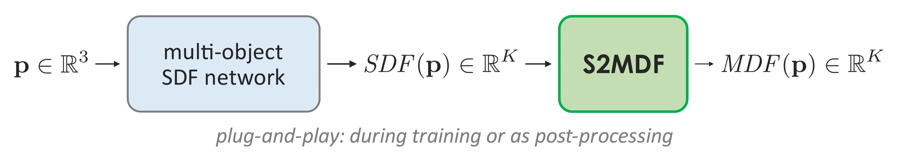

<h1 style="text-align: center;">S2MDF: A Plug-And-Play Layer for Intersection-Free Multi-Object Signed Distance Fields</h1>
<h2 style="text-align: center;">Paper accepted to NeurIPS 2026</h2>

<h2 style="text-align: center;">
    <a class="page-link" href="https://scholar.google.com/citations?user=kpTb5N8AAAAJ&hl=en">Deniz Sayin Mercadier</a>*,
    <a class="page-link" href="https://scholar.google.com/citations?user=UxEI4sQAAAAJ&hl=en">Federico Stella</a>*,
    Aurel Bizeau,
    <a class="page-link" href="https://scholar.google.com/citations?hl=en&user=f2LbcbAAAAAJ">Nicolas Talabot</a>,
    <a class="page-link" href="https://scholar.google.com/citations?user=kzFmAkYAAAAJ&hl=en">Pascal Fua</a>
</h2>

* equal contribution

    

    

    	

    
<a href="https://arxiv.org/abs/2605.29761" style="color: #fdfdfd;">
        <i class="ai ai-arxiv"></i> Paper + Supp (Arxiv)
    </a>

    
<a href="https://youtu.be/Fm-X_E88Es8" style="color: #fdfdfd;">
        &#9654; Video (5 min)
    </a>

    
<a style="color: #fdfdfd;">
        <i class="ai ai-arxiv"></i> Poster - Coming Soon
    </a>

    

<object data="/assets/github_logo.svg"></object>
        <a style="color: #fdfdfd;">Code - Coming Soon</a>
    

<h2 style="text-align: center;"> Feel free to contact us for any questions! </h2>

<h1 style="text-align: center;">S2MDF at a glance</h1>
<video class="s2mdf-video" src="/papers/s2mdf/assets/explainer.mp4" autoplay muted loop playsinline controls disablepictureinpicture controlslist="nodownload noplaybackrate"></video>

	Each object of a compositional scene has its own Signed Distance Field (SDF), so nothing prevents two objects from interpenetrating. We require the two smallest SDF values at every point to sum to a non-negative number: the <b>MDF constraint</b>, which rules out intersections (Theorem 1). S2MDF enforces it in closed form by shifting all SDFs together (Shift-All), and since linear interpolation preserves the constraint (Theorem 2), standard Marching Cubes / Tetrahedra produce intersection-free meshes.

	<h1 style="text-align: center;">Abstract</h1>
	Compositional implicit surface representations model scenes as collections of objects, each encoded by a Signed Distance Field (SDF). A fundamental limitation of this approach is that multiple SDFs can produce geometries that interpenetrate, violating physical plausibility. Existing mitigation strategies rely on soft penalty terms that reduce but do not eliminate intersections, and require careful loss weighting. To truly prevent interpenetration, we propose a hard constraint on vector-valued SDFs and introduce S2MDF, a lightweight plug-and-play module that enforces the constraint on any object-compositional SDF representation without architectural modifications. It introduces negligible computational overhead and is compatible with linearly-interpolated standard meshing algorithms such as Marching Cubes. It can be applied during training or as a post-processing step. Experiments on multiple state-of-the-art compositional methods show that S2MDF reduces intersections to numerical precision while preserving reconstruction quality, outperforming existing mitigation strategies.

<h1 style="text-align: center;">Presentation</h1>

  

    <iframe src="https://www.youtube-nocookie.com/embed/Fm-X_E88Es8" title="S2MDF presentation (NeurIPS 2026)" frameborder="0" allow="accelerometer; clipboard-write; encrypted-media; gyroscope; picture-in-picture; web-share" referrerpolicy="strict-origin-when-cross-origin" allowfullscreen></iframe>
  

<h1 style="text-align: center; margin-top: 30px;">A plug-and-play layer</h1>

	S2MDF sits on top of any network that predicts one SDF per object, without changing its architecture. It acts point-wise, adds no parameters and only a negligible cost, and can be used while training or as post-processing on an already-trained model.

<h1 style="text-align: center;">Results</h1>

	

		We plug S2MDF into three state-of-the-art compositional methods: ObjectSDF++ (indoor scenes), PartSDF (part-based shapes) and MedTet (medical shapes). Each video zooms in and then shows the objects in transparency: <b>red</b> regions are intersections between objects, <b>green</b> regions are contacts without interpenetration.
	

	

Vanilla

S2MDF Shift-All (PP)

S2MDF Shift-All (Train)

	<h3>ObjectSDF++</h3>
	
Replica room 0, 256&#xB3; grid. (Train) uses the skip-connection variant.

	<video class="s2mdf-video" src="/papers/s2mdf/assets/compare_scene.mp4" autoplay muted loop playsinline controls disablepictureinpicture controlslist="nodownload noplaybackrate"></video>

	<h3>PartSDF</h3>
	
PartNet chairs, 128&#xB3; grid.

	<video class="s2mdf-video" src="/papers/s2mdf/assets/compare_chair.mp4" autoplay muted loop playsinline controls disablepictureinpicture controlslist="nodownload noplaybackrate"></video>

	<h3>MedTet</h3>
	
MM-WHS heart, 64&#xB3; tetrahedral grid subdivided once.

	<video class="s2mdf-video" src="/papers/s2mdf/assets/compare_heart.mp4" autoplay muted loop playsinline controls disablepictureinpicture controlslist="nodownload noplaybackrate"></video>
	
intersectioncontact

	
PP: post-processing of the trained vanilla model. Train: S2MDF used during training.

<h1 style="text-align: center; margin-top: 30px;">Quantitative results</h1>

<table class="booktabs">
  <thead>
    <tr><th></th><th>MCD &#x2193;</th><th>MNC &#x2191;</th><th>F1 &#x2191;</th><th>IoU &#x2191;</th><th>IV &#x2193;</th></tr>
  </thead>
  <tbody>
    <tr class="group"><td colspan="6">ObjectSDF++ &#xB7; Replica, 8 scenes &#xB7; MCD &#xD7;10&#x207B;&#xB2;</td></tr>
    <tr><td>Vanilla ObjectSDF++</td><td>10.677</td><td>77.953</td><td>66.946</td><td>&#x2013;</td><td>1.4&#xB7;10&#x207B;&#xB3;</td></tr>
    <tr><td>S2MDF Shift-All (PP)</td><td>3.345</td><td>78.058</td><td>68.325</td><td>&#x2013;</td><td class="iv">1.3&#xB7;10&#x207B;&#x2077;</td></tr>
    <tr><td>S2MDF Shift-All (Train)*</td><td>3.942</td><td>78.430</td><td>68.623</td><td>&#x2013;</td><td class="iv">1.5&#xB7;10&#x207B;&#x2076;</td></tr>
    <tr class="group"><td colspan="6">PartSDF &#xB7; PartNet chairs &#xB7; MCD &#xD7;10&#x207B;&#x2074;</td></tr>
    <tr><td>Vanilla PartSDF</td><td>4.331</td><td>95.119</td><td>96.731</td><td>85.630</td><td>1.9&#xB7;10&#x207B;&#xB3;</td></tr>
    <tr><td>S2MDF Shift-All (PP)</td><td>1.973</td><td>94.824</td><td>98.005</td><td>89.173</td><td class="iv">5.2&#xB7;10&#x207B;&#x2079;</td></tr>
    <tr><td>S2MDF Shift-All (Train)</td><td>2.120</td><td>94.823</td><td>98.039</td><td>89.297</td><td class="iv">5.7&#xB7;10&#x207B;&#x2079;</td></tr>
    <tr class="group"><td colspan="6">MedTet &#xB7; MM-WHS heart &#xB7; MCD &#xD7;10&#x207B;&#x2074;</td></tr>
    <tr><td>Vanilla MedTet</td><td>23.863</td><td>94.333</td><td>97.470</td><td>83.580</td><td>3.4&#xB7;10&#x207B;&#x2074;</td></tr>
    <tr><td>S2MDF Shift-All (PP)</td><td>31.099</td><td>94.316</td><td>97.297</td><td>83.694</td><td class="iv">9.9&#xB7;10&#x207B;&#xB9;&#xB2;</td></tr>
    <tr><td>S2MDF Shift-All (Train)</td><td>23.094</td><td>94.407</td><td>97.556</td><td>83.901</td><td class="iv">4.6&#xB7;10&#x207B;&#xB9;&#xB9;</td></tr>
  </tbody>
</table>

	Same reconstruction quality, with the <b>intersection volume (IV) down to numerical precision</b>. MCD: mean Chamfer distance, MNC: mean normal consistency, IV: intersection volume. *Skip-connection variant. Mean over 3 runs. See the paper for comparisons with existing mitigation strategies.

<h2> BibTeX </h2>
If you find our work useful, please cite it:



<pre class="highlight"><code>@inproceedings{sayinmercadierstella2026s2mdf,
  author    = {Sayin Mercadier, Deniz and Stella, Federico and Bizeau, Aurel and Talabot, Nicolas and Fua, Pascal},
  title     = {{S2MDF}: A Plug-And-Play Layer for Intersection-Free Multi-Object Signed Distance Fields},
  booktitle = {Advances in Neural Information Processing Systems},
  year      = {2026}
}
</code></pre>


